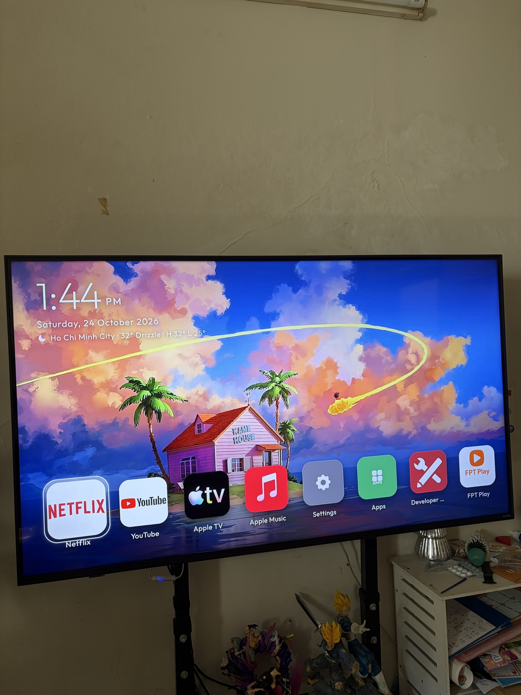

# webos-vibehack-skin

**Tiếng Việt** — Một bộ "skin" cho launcher [webos-vibehack](https://github.com/OmkarK97/webos-vibehack) trên tivi LG webOS: hình nền tràn màn hình, đồng hồ lớn + thời tiết ở góc trái, và **một hàng icon vuông ở đáy** với tên app bên dưới — giống phong cách Apple TV / tvOS.

**English** — A skin for the [webos-vibehack](https://github.com/OmkarK97/webos-vibehack) launcher on LG webOS TVs: a full-screen wallpaper, a big clock + weather readout in the top-left corner, and **a single bottom row of square app icons** with labels — Apple TV style.

> Ảnh chụp thật trên LG QNED 55" webOS 25 — nền Kame House (Dragon Ball), thời tiết TP. Hồ Chí Minh.
> Real photo from an LG QNED 55" running webOS 25 — Kame House (Dragon Ball) wallpaper, Ho Chi Minh City weather.

## Có gì trong bộ này / What's inside

| File | Mô tả / Description |
| --- | --- |
| `app/style.css`, `app/index.html`, `app/app.js` | Skin 2: nền wallpaper, đồng hồ 132px + ngày tháng + thời tiết, dock icon vuông 168px một hàng ở đáy, trượt ngang bằng phím trái/phải, giữ OK để sắp xếp / Skin 2: wallpaper background, 132px clock + date + weather, one bottom row of 168px square tiles, side-scrolling, hold OK to rearrange |
| `app/wallpaper.jpg` | Hình nền Kame House 2560×1440 (thay bằng ảnh 16:9 bất kỳ của bạn) / Kame House wallpaper 2560×1440 (drop in any 16:9 image) |
| `app/config.js` | Cấu hình mẫu: dock = Netflix, YouTube, Apple TV, Apple Music; ẩn 8 Ball Pool; ghim ô Settings lên đầu lưới / Sample config |
| `sync-apps.py` | Bản đã vá: tự áp icon trong `icons-custom/` sau mỗi lần sync + tự thêm 2 ô đặc biệt **Settings** và **Inputs** / Patched: applies `icons-custom/` overrides on every sync and injects synthetic **Settings** and **Inputs** tiles |
| `icons-custom/` | Bộ icon 1024×1024 nét cao (Netflix, YouTube, FPT Play, Apple TV, Apple Music...) — ghi đè icon 130px mờ mà tivi cấp / High-resolution 1024×1024 replacement icons — the TV only serves blurry 130px ones |

Thời tiết lấy từ [Open-Meteo](https://open-meteo.com) (miễn phí, không cần tài khoản), mặc định tọa độ TP. Hồ Chí Minh — đổi `latitude/longitude` trong `app.js` (hàm `fetchWeather`) cho nơi của bạn.
Weather comes from [Open-Meteo](https://open-meteo.com) (free, no key), defaulting to Ho Chi Minh City — change `latitude/longitude` in `fetchWeather` inside `app.js`.

## Cài đặt / Install

Đọc **[HUONG-DAN.md](HUONG-DAN.md)** (tiếng Việt) hoặc **[GUIDE-EN.md](GUIDE-EN.md)** (English). Tóm tắt: cài bản gốc webos-vibehack trước → chép các file trong repo này đè lên → chạy lại `TV_HOST=<IP tivi> ./install.sh`.

Short version: install the original webos-vibehack first → copy the files from this repo over it → run `TV_HOST=<your TV IP> ./install.sh` again.

## Nguồn gốc / Credits

- Launcher gốc: [webos-vibehack](https://github.com/OmkarK97/webos-vibehack) của OmkarK97, chuyển từ [cleanyourtv / tv-vibehack](https://github.com/Gathin23/cleanyourtv) của Gathin. Skin này chỉ thay lớp giao diện + vài tiện ích, mọi cơ chế (Developer Mode, home-watch, sync) là của bản gốc.
- Hình nền là fan-art Dragon Ball (Kame House) sưu tầm từ Pinterest; icon các app là artwork của chính các hãng. Repo này phục vụ mục đích cá nhân/học hỏi — mọi quyền thuộc về chủ sở hữu tương ứng.
- The wallpaper is Dragon Ball fan art found on Pinterest; app icons are the respective brands' artwork. Shared for personal/educational use — all rights belong to their owners.

Làm bởi / Made by [khuong nguyen](https://khuong.cloud) với sự trợ giúp của audi (Muse).
